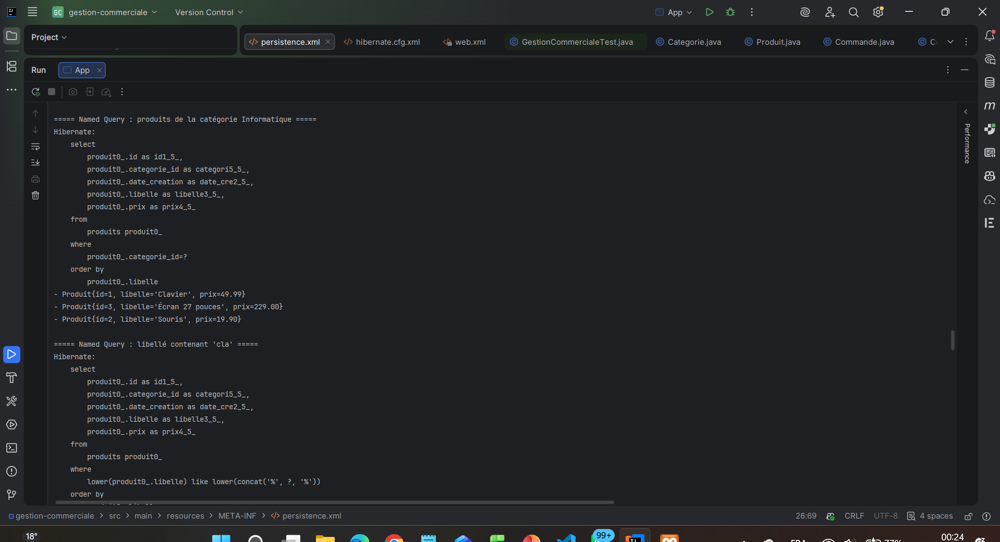
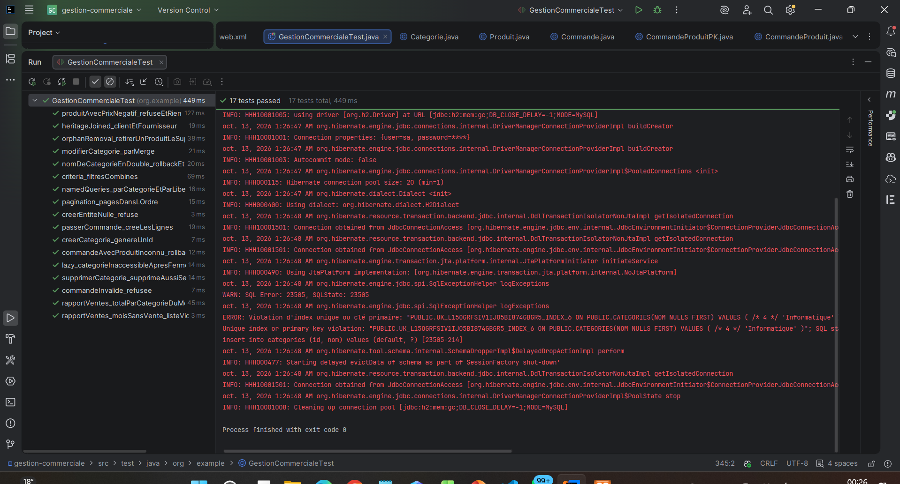

# TP6 – Gestion commerciale (JPA / Hibernate)

Application de gestion commerciale : catégories, produits, clients, fournisseurs et commandes,
avec un **rapport de ventes mensuel par catégorie** construit avec la Criteria API et exposé par une servlet.

## Technologies

| Outil | Version |
|---|---|
| Java | 11+ (testé avec JDK 23) |
| JPA | 2.2 (`javax.persistence`) |
| Hibernate | 5.6.15.Final |
| MySQL | 8 (application) |
| H2 | 2.1.214 (tests, base en mémoire) |
| JUnit | 4.13.2 |
| Servlet | 4.0 (Tomcat 9) |

## Architecture

```
src/main/java/org/example
├── App.java                      démonstration complète (MySQL)
├── entities/                     Categorie, Produit, Commande, CommandeProduit(+PK),
│                                 User (abstraite), Client, Fournisseur
├── dao/GenericDAO.java           CRUD générique (une transaction par opération)
├── service/
│   ├── CrudService.java          validations communes + hook valider()
│   ├── ProduitService.java       named queries, Criteria, pagination, JOIN FETCH
│   ├── CommandeService.java      commande en UNE transaction (rollback si erreur)
│   ├── RapportService.java       rapport de ventes (cb.sum + cb.prod + groupBy)
│   └── VenteParCategorie.java
├── util/JpaUtil.java             une seule EntityManagerFactory (singleton)
├── util/HibernateUtil.java       SessionFactory (hibernate.cfg.xml)
└── web/
    ├── RapportVentesServlet.java GET /rapport-ventes?mois=AAAA-MM
    └── AppContextListener.java   ferme les factories à l'arrêt du serveur
src/main/resources
├── META-INF/persistence.xml      unité "defaultPU" (MySQL)
└── hibernate.cfg.xml
src/test/java/org/example/GestionCommercialeTest.java   17 tests (H2)
```

## Modèle

- `Categorie 1 — N Produit` (`cascade = ALL`, `orphanRemoval = true`)
- `Commande N — N Produit` via l'entité `CommandeProduit` (clé composée `@EmbeddedId` + `@MapsId`, colonne `quantite`)
- `User` ← `Client`, `Fournisseur` : héritage **JOINED** (tables `users`, `clients`, `fournisseurs`)

## Corrections apportées à l'énoncé

1. Le `GenericDAO` utilise l'unité JPA `defaultPU` : il faut donc un `META-INF/persistence.xml` (le `hibernate.cfg.xml` seul ne suffit pas).
2. Dans un fichier XML, le `&` de l'URL MySQL doit s'écrire `&amp;`.
3. L'import `javax.persistence.EntityTransaction` manquait dans le DAO.
4. `CommandeProduit` : la commande n'a pas encore d'id quand on crée la ligne ; la clé est donc remplie par `@MapsId` au moment du `persist`.
5. Le test de l'énoncé `fetched.getCategorie().getNom()` lève une `LazyInitializationException` (EntityManager fermé, relation LAZY). Ajout de `getByIdAvecCategorie()` avec `JOIN FETCH`.
6. `Client` et `Fournisseur` ajoutés aux mappings.
7. Le `web.xml` généré par l'archétype (version 2.3) ignore `@WebServlet` : remplacé par la version 4.0.

## Lancer le projet

### Application (MySQL)
1. Démarrer MySQL (la base `gestion_commerciale` est créée automatiquement).
2. Adapter `javax.persistence.jdbc.user` / `password` dans `persistence.xml`.
3. Lancer `App.java` (ou `mvn compile exec:java`).

### Tests (H2, sans MySQL)
```
mvn test
```

**Résultat : 17 tests réussis.**

Scénarios testés : CRUD et merge, nom de catégorie en double (rollback), validations (prix négatif, entité nulle),
LazyInitializationException vs JOIN FETCH, named queries, Criteria avec filtres combinés, pagination,
orphanRemoval, héritage JOINED, commande valide / produit inconnu (rollback complet) / quantité nulle,
rapport de ventes (mois inclus, mois exclu, mois vide).

> L'erreur « Violation d'index unique » visible dans le log des tests est volontaire : elle vient du test
> du nom de catégorie en double, qui vérifie que la base refuse le doublon.

### Servlet (optionnel, Tomcat 9)
`mvn package` puis déployer `target/gestion-commerciale.war` dans Tomcat **9** (Tomcat 10 utilise `jakarta.*`).
Ouvrir `http://localhost:8080/gestion-commerciale/rapport-ventes` ou `...?mois=2026-09`.

## Captures

### Exécution de App


### Tests JUnit


## Auteur
Hibatalah Hamrani – EMSI Marrakech